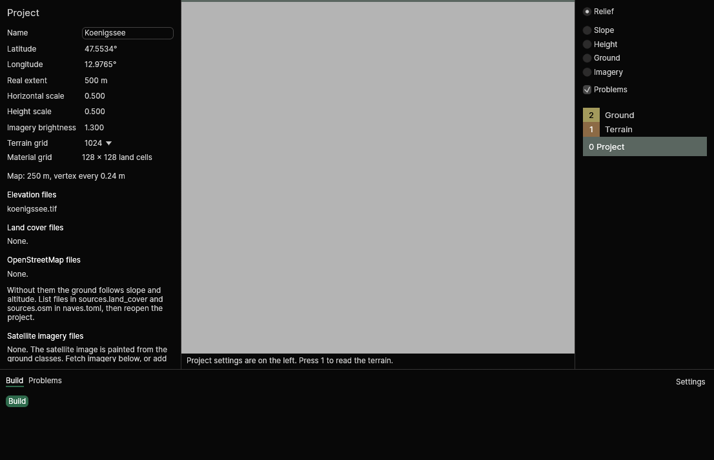
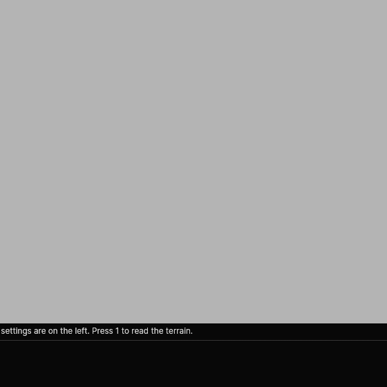

<!--
SPDX-FileCopyrightText: 2026 Bernd Zeimetz <bernd@bzed.de>

SPDX-License-Identifier: AGPL-3.0-or-later
-->

# GUI

```sh
naves gui [<project folder>]
```

opens the project in the current folder (or the one you name) in a window titled *Náves – (project name)*.
There is no object editing yet; the window shows the project, reads the terrain and builds it.



*Level 1, Terrain, with the Ground base map and the layer Too steep to walk switched on. The data is the Königssee crop of the test fixtures (`tests/fixtures`: Copernicus GLO-30, ESA WorldCover, OpenStreetMap); the hatching is in the top left, where the ground is steeper than 60°.*

## The stack (right)

The right column is a stack of **levels**, drawn like a geologist's column: level 0, Project, at the bottom, and
what lives on the ground above it. Click a level, or press its number, to work on it. The active level is
the thick row in its own colour. A level appears when it can do something; today these are:

| Key | Level | The left panel shows |
|---|---|---|
| 0 | Project | the project settings (below) |
| 1 | Terrain | map size, vertex spacing, lowest and highest point, the elevation files |
| 2 | Ground | the share of the map for each ground class, the land cover and OpenStreetMap files |

Hover a row to see its key; **F1** lists all [keyboard shortcuts](shortcuts.md) of the level you are in, and **Ctrl+B** builds.

### Layers

A level can have **layers**: things drawn over the base map. They are in the stack, under the active level, as
checkboxes. Switching one on shows its key under it (the symbol as drawn on the map). Level 1 has **Too steep to
walk**: diagonal hatching over ground steeper than 60° (a provisional limit, the steepest slope of the Livonia
navigation mesh, so the layer may miss some ground that is too steep, but never marks walkable ground), and
**Terrain changes**: what the roads did to the terrain, cut in earth brown and fill in blue, stronger the more
(half opaque from 5 m, nothing below a quarter of a metre).

Level 4, **Roads and paths**, has **Roads** (at their true width, at least a pixel and a half, with a white casing so
that they read on every base map), **Paths** (dashed, brown) and **Drivable**, drawn along each road piece: green
for a piece vehicles can drive, amber for one that is steeper than its family is aimed at but still drivable, red
and twice as wide with cross ticks for one that cannot be driven, grey for a track that only has to be walkable.
The road layers appear when the roads are generated, which takes a moment after the project opens (the panel says
"Placing roads"); they are not drawn before. The roads need the sources listed in `sources.osm`, `armake2` and
the DayZ Server install: without a tool the panel says which and has a button that opens the settings.
**Click a road** to read its model, surface, grade, cross fall, distance from the ground and whether it can be
driven, and where it was generated from. What is wrong with the roads is listed under Problems, each with its
position.

The levels you are not working on are drawn faded, at 40 %, so that you see what you work against. **H** hides the
active level, **Shift+H** shows the others in full; making a hidden level active shows it again. Layers and the
active level belong to the window and are not saved in `naves.toml`. Switching, fading and hiding draw nothing
anew.

A 3 px band in the active level's colour runs along the top of the map, and a line below the map says what
you can do. The numbers never change: key 4 is Roads and paths.

Above the stack are the **base maps**, one at a time: **Relief** (shaded, sun in the north-west), **Slope**
(green flat to red at 45° and steeper; the surface painter makes ground above 35° rock), **Height**, **Ground**
and **Imagery**.

- **Ground** shows the ground classes Náves will paint (grass, rock, forest and soil), in the colours of the
  satellite image, with a legend under the row. It is decided from the land cover and OpenStreetMap files
  of the project, and from slope and altitude where they say nothing, exactly as the build does. The map takes
  a little longer to appear when the project lists such files.
- **Imagery** shows the satellite or aerial images of `sources.imagery`, merged as the build merges them, so
  you can check the result before a long build. Ground that no file covers is drawn in a checkered grey, so
  a gap cannot be mistaken for ground. Without imagery files the map says how to add them.

On a small window the bottom dock folds to its button row (below 560 px of height), then the left panel to
a thin strip with a button that opens it (below 900 px of width). The map stays.

## Project settings (level 0, left)

The fields of [`naves.toml`](project-file.md): name, centre, real extent, both scales and the two grid sizes. A
change is checked at once and saved to `naves.toml` when it is valid. A value that is out of range is **not**
saved; a red line under the form says which field and why, and the file stays as it was. A saved change
recomputes the map. The line below the form shows the size of the map in metres and the distance between
heightmap vertices.

The elevation, land cover and OpenStreetMap files are listed under the form. They are edited in `naves.toml` for now;
see [the project file](project-file.md#sources). Changing a list reloads the map.

## Map (centre)

A top-down view of the heightmap, north up.

- **Space + drag** or the **middle mouse button + drag** moves the map (before this version the left button did;
  it is kept for the tools of the editor). **Scroll** zooms in and out around the pointer.
- **Click** reads a point in the active level: in Terrain its position, latitude and longitude, height and
  slope, in Ground the ground class. The result is under the stack, and a ring marks the point. **Alt+click** picks in
  the highest level that has something there and switches to it. Levels you hid (H) pick nothing. **Esc** clears it.
- **F** centres the map on the selected point, **Shift+F** shows the whole map.



The project panel has a section **Satellite imagery files**:

- **Available for this area** lists the sources of the [imagery catalogue](imagery.md) that have something for the
  area, best first, each with how much of the map it covers, its pixel size and its licence. A source that does not
  allow commercial use says **non-commercial** in words. **Fetch** downloads it into the project in the background:
  the log shows the steps, **Cancel** stops it and leaves no half-written file, and one fetch runs at a time. For a
  source of scenes you can type the dates (`YYYY-MM-DD`) of the search next to *Dates for scenes*; without them the
  last two summers are searched. The files appear in the list below and the Imagery map updates.
- The **files of the project**, in the order that decides among equally sharp images (the first is drawn on top),
  with **Up**, **Down** and **Remove**. Remove only takes a file off the list; it stays in the project folder, and the
  GUI says so. Under the list, one line per file tells what the merge found: how much of the map it covers, how much of
  that other images cover as well, and the colour correction applied (or that its colours are kept).
- **Imagery brightness**, in the settings above, sets `[imagery] brightness`; the Imagery map shows the result at once.
- **Add your own file** takes a path inside the project folder, a credit and a licence; the file is accepted only when
  all are there, and a licence with `NC` in it needs the box *The licence does not allow commercial use*.

The project panel lists the **satellite imagery files** with their licences. A file whose licence does not allow
commercial use says so in words, and a line **Non-commercial map** appears when such a file touches the map.
Notes of the merge (a file that overlaps no other image, so its colours are not matched) appear in the log.

If the project has no elevation files, or the files do not cover the area, the map says so instead of drawing.

## Settings

The **Settings** button at the right end of the dock (or **F2**) opens the [settings](settings.md): keyboard shortcuts, the map and the paths of the external tools. They apply to every project.

## The dock (bottom)

The dock has the tabs **Build** and **Problems**. On a low window it folds to its tab row.

**Build** runs the same build as [`naves build`](cli.md) in the background (also with **Ctrl+B**). The log shows
the steps as they happen; when the build succeeds the last lines give the mod and mission folders, and when it
fails they give the reason (a missing tool is named together with the variable to set, see
[Installation](installation.md)). The button is disabled while a build is running or while the settings hold an
invalid value.

**Problems** lists what is wrong: the warnings and the error of the last build, the notes of the imagery merge,
and a setting that was not saved. They stay in the build log too. The tab says how many there are ("Problems 3");
with none it says "No problems". The list follows the level you are in, and the box **All** shows every level.
A row that has a position takes the map there when you click it. **F8** goes to the next problem and
**Shift+F8** to the previous one, wrapping around. The row *Problems* above the stack switches the red
diamonds on the map on and off.
