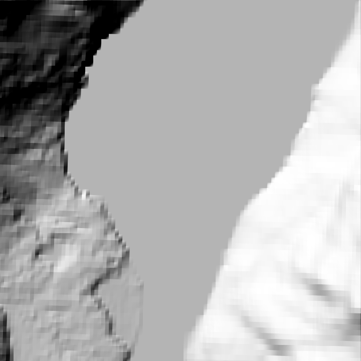

<!--
SPDX-FileCopyrightText: 2026 Bernd Zeimetz <bernd@bzed.de>

SPDX-License-Identifier: AGPL-3.0-or-later
-->

# GUI

```sh
naves gui [<project folder>]
```

opens the project in the current folder (or the one you name) in a window titled *Náves – (project name)*.
The window has three parts. This first version shows the project and builds it; there is no object editing yet.



*The map view with the Hillshade overlay (the Königssee test area).*

## Settings (left)

The fields of [`naves.toml`](project-file.md): name, centre, real extent, both scales and the two grid sizes. A
change is checked at once and saved to `naves.toml` when it is valid. A value that is out of range is **not**
saved; a red line under the form says which field and why, and the file stays as it was. A saved change
recomputes the map. The line below the form shows the size of the map in metres and the distance between
heightmap vertices.

The elevation, land cover and OpenStreetMap files are listed under the form. They are edited in `naves.toml` for now;
see [the project file](project-file.md#sources). Changing a list reloads the map.

## Map (centre)

A top-down view of the heightmap, north up.

- **Drag** to move the map, **scroll** to zoom in and out around the pointer.
- **Hillshade** shows relief with the sun in the north-west, **Slope** colours the ground from green (flat) to red
  (45° and steeper; the surface painter makes ground above 35° rock), **Height** shades by height.
- **Surface** shows the ground classes Náves will paint (grass, rock, forest and soil), in the colours of the
  satellite image, with a legend next to the buttons. It is decided from the land cover and OpenStreetMap files
  of the project, and from slope and altitude where they say nothing, exactly as the build does. The map takes
  a little longer to appear when the project lists such files.
- **Imagery** shows the satellite or aerial images of `sources.imagery`, merged as the build merges them, so
  you can check the result before a long build. Ground that no file covers is drawn in a checkered grey, so
  a gap cannot be mistaken for ground. Without imagery files the map says how to add them.


The project panel lists the **satellite imagery files** with their licences. A file whose licence does not allow
commercial use says so in words, and a line **Non-commercial map** appears when such a file touches the map.
Notes of the merge (a file that overlaps no other image, so its colours are not matched) appear in the log.

If the project has no elevation files, or the files do not cover the area, the map says so instead of drawing.

## Build (bottom)

**Build** runs the same build as [`naves build`](cli.md) in the background. The log shows the steps as they
happen; when the build succeeds the last lines give the mod and mission folders, and when it fails they give the
reason (a missing tool is named together with the variable to set, see [Installation](installation.md)). The
button is disabled while a build is running or while the settings hold an invalid value.
